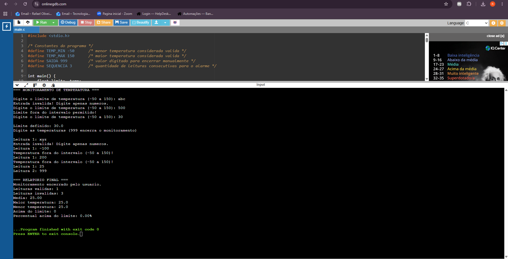
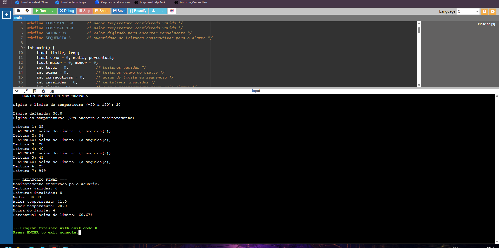
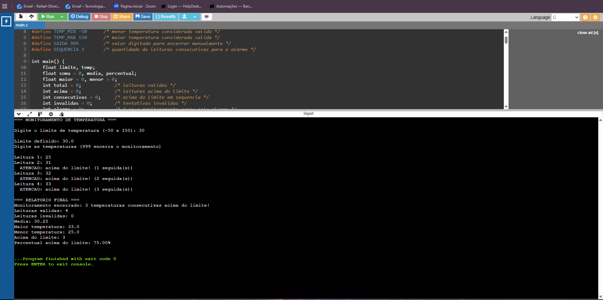

# Desafio Monitoramento de Temperatura

## 1. Identificação

- **Aluno(a):** Rafael Oliveira da Silva
- **Disciplina:** Algoritmos e Pensamentos Computacionais
- **Professora:** Profa. Karla Sartin
- **Título do projeto:** Desafio Monitoramento de Temperatura

## 2. Objetivo

O programa simula o monitoramento de um sensor de temperatura. O usuário define um limite e vai digitando as leituras. O programa avisa quando uma leitura passa do limite e encerra sozinho se houver **três leituras seguidas acima dele**. No final, mostra um relatório com média, maior, menor, quantidade e percentual de leituras acima do limite.

## 3. Funcionamento do programa

**Como o limite é definido:** no início o programa pede o limite ao usuário. Ele só é aceito se for um número entre -50 e 150. Caso contrário, o programa mostra uma mensagem de erro e pede de novo.

**Como as leituras são realizadas:** dentro de um laço `while`, o programa pede uma temperatura por vez (Leitura 1, Leitura 2, ...). Cada leitura válida entra na soma, é comparada com o maior e o menor valor já lidos e é contada no total.

**Como valores inválidos são tratados:** se o usuário digitar letras ou um número fora do intervalo de -50 a 150, o programa mostra uma mensagem e pede o valor de novo. Essas tentativas não entram nos cálculos, mas são contadas como "leituras inválidas" no relatório. O `scanf` retorna 1 quando consegue ler um número, e é isso que usamos para detectar letras. Depois de cada leitura, o buffer do teclado é limpo para não dar problema na próxima.

**Como identifica temperaturas acima do limite:** cada leitura válida é comparada com o limite (`temp > limite`). Se for maior, soma 1 em `acima` e mostra um aviso na tela.

**Como funciona a contagem de consecutivas:** existe uma variável `consecutivas`. Quando a temperatura está acima do limite, ela aumenta em 1. Quando a temperatura **não** está acima do limite, ela volta para 0, porque a sequência foi quebrada.

**Condição de encerramento:** o monitoramento termina quando `consecutivas` chega a 3 (encerramento automático). Também adicionei uma saída manual: digitar **999** encerra o programa. Fiz isso para ser possível testar cenários sem alarme, como o Teste 2.

**Relatório final:** mostra a causa do encerramento, leituras válidas e inválidas, média, maior, menor, quantidade acima do limite e percentual acima do limite. Se nenhuma leitura válida foi feita, o programa avisa e não calcula média (evita divisão por zero).

## 4. Estruturas de repetição utilizadas

- **`do...while` na leitura do limite:** o programa precisa pedir o limite pelo menos uma vez, então a condição é testada depois.
- **`do...while` na validação de cada temperatura:** mesma ideia, pede o valor pelo menos uma vez e repete enquanto for inválido.
- **`while` no laço principal do monitoramento:** o monitoramento pode ser encerrado a qualquer momento (alarme ou 999), então a condição `continuar` é testada antes de cada rodada.

## 5. Como executar

```bash
gcc monitoramento.c -o monitoramento
./monitoramento
```

No Windows (MinGW), execute com `monitoramento.exe`.

Os testes apresentados na seção 6 foram executados no compilador online **OnlineGDB** (https://www.onlinegdb.com), usando linguagem C e o mesmo código-fonte deste repositório.

## 6. Testes realizados

### Teste 1: validação de entradas inválidas

Entradas: limite `abc`, `500`, `30`; depois temperaturas `xyz`, `-100`, `200`, `25` e `999`.

```
Digite o limite de temperatura (-50 a 150): Entrada invalida! Digite apenas numeros.
Digite o limite de temperatura (-50 a 150): Limite fora do intervalo permitido!
Digite o limite de temperatura (-50 a 150):
Limite definido: 30.0
Leitura 1: Entrada invalida! Digite apenas numeros.
Leitura 1: Temperatura fora do intervalo (-50 a 150)!
Leitura 1: Temperatura fora do intervalo (-50 a 150)!
Leitura 1: Leitura 2:
Monitoramento encerrado pelo usuario.
Leituras validas: 1
Leituras invalidas: 3
```

**Resultado:** o programa recusou `abc` e `500` como limite e recusou `xyz`, `-100` e `200` como temperatura. Só o `25` foi aceito, e as 3 tentativas inválidas foram contadas.



### Teste 2: temperaturas acima do limite, mas não consecutivas

Entradas: limite `30`; temperaturas `35, 36, 28, 40, 41, 29` e `999`.

```
Leitura 1:   ATENCAO: acima do limite! (1 seguida(s))
Leitura 2:   ATENCAO: acima do limite! (2 seguida(s))
Leitura 3:   (28, contador volta a zero)
Leitura 4:   ATENCAO: acima do limite! (1 seguida(s))
Leitura 5:   ATENCAO: acima do limite! (2 seguida(s))
Leitura 6:   (29, contador volta a zero)
Leitura 7:   (999, encerra)

=== RELATORIO FINAL ===
Monitoramento encerrado pelo usuario.
Leituras validas: 6
Leituras invalidas: 0
Media: 34.83
Maior temperatura: 41.0
Menor temperatura: 28.0
Acima do limite: 4
Percentual acima do limite: 66.67%
```

**Resultado:** houve temperaturas acima do limite, mas nunca 3 seguidas. O contador voltou a zero quando uma leitura ficou dentro do limite, e o programa só parou com o `999`.



### Teste 3: três temperaturas consecutivas acima do limite

Entradas: limite `30`; temperaturas `25, 31, 32, 33`.

```
Leitura 1:
Leitura 2:   ATENCAO: acima do limite! (1 seguida(s))
Leitura 3:   ATENCAO: acima do limite! (2 seguida(s))
Leitura 4:   ATENCAO: acima do limite! (3 seguida(s))

=== RELATORIO FINAL ===
Monitoramento encerrado: 3 temperaturas consecutivas acima do limite!
Leituras validas: 4
Leituras invalidas: 0
Media: 30.25
Maior temperatura: 33.0
Menor temperatura: 25.0
Acima do limite: 3
Percentual acima do limite: 75.00%
```

**Resultado:** na terceira leitura seguida acima de 30, o programa encerrou sozinho e mostrou o relatório.



## Questão final de reflexão

**Por que você escolheu while, do...while ou uma combinação das duas estruturas? Em qual parte do algoritmo a diferença entre testar a condição antes ou depois da execução foi importante para sua solução?**

Escolhi usar uma combinação das duas. O `do...while` foi usado nas leituras (do limite e de cada temperatura), porque o programa precisa pedir o valor **pelo menos uma vez** antes de saber se ele é válido. Se eu usasse `while` ali, teria que ler o valor uma vez antes do laço e repetir o mesmo código dentro dele. Já o `while` foi usado no laço principal, porque o monitoramento precisa testar a condição `continuar` **antes** de cada rodada, já que ele pode terminar pelo alarme das 3 consecutivas ou pelo 999. A diferença entre testar antes ou depois foi mais importante na validação das entradas: com o `do...while`, o código ficou mais curto e sem repetição.
